# Genitem

**Generar, adaptar y verificar ítems de cuestionarios con IA, íntegramente en su propio ordenador.**

Sitio web: <https://genitem.recherche-formation.com>

[Français](README.md) · [English](README.en.md) · **Español** · [Deutsch](README.de.md) · [Português](README.pt.md) · [Italiano](README.it.md)

> **Traducción realizada con IA.** Este texto es una traducción producida con
> Claude (Anthropic) a partir del original francés. En caso de discrepancia,
> prevalece la versión francesa.

## Vídeo de presentación

<a href="https://genitem.recherche-formation.com/wp-content/uploads/data/genitem-es.mp4">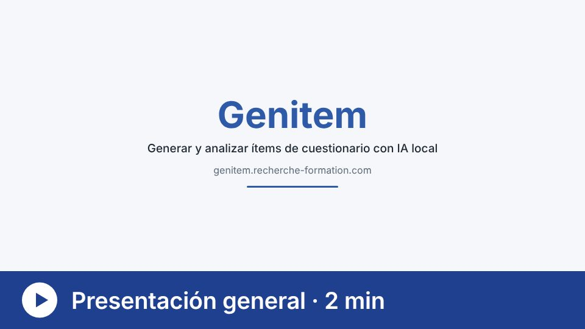</a>

[Ver la presentación general de Genitem (2 minutos)](https://genitem.recherche-formation.com/wp-content/uploads/data/genitem-es.mp4)

---

## Qué es

Genitem (Jan et al., 2026) es un conjunto de herramientas gratuitas, utilizables
en el navegador, para investigadoras e investigadores que construyen, adaptan y
verifican cuestionarios, encuestas y escalas de medida. La IA generativa realiza
el trabajo repetitivo. La experiencia humana conserva el control de cada
decisión.

Todos los modelos de lenguaje se ejecutan **en local**, en el ordenador de quien
lleva a cabo la investigación, gracias a [Ollama](https://ollama.com) (Windows,
macOS o Linux). Ningún ítem, respuesta ni dato personal se envía a un servicio
externo. Por ello, Genitem es adecuado para estudios sujetos a exigencias
éticas o de protección de datos estrictas.

La interfaz está disponible en seis idiomas: francés, inglés, español, alemán,
portugués e italiano.

---

## La herramienta central: la generación de ítems

La generación de ítems se realiza en dos etapas.

1. **Agentes de IA organizados en una jerarquía.** Un configurador coordina su
   trabajo. La persona investigadora elige el modelo y define el papel de cada
   agente. Por ejemplo, un agente redacta un conjunto de ítems sobre un
   constructo dado y, después, varios agentes revisores (habitualmente entre
   tres y ocho) comprueban de forma independiente que los ítems se ajustan al
   tema, respetan las reglas de redacción y no contienen sesgos éticos. Este
   ciclo de revisión se repite varias veces, y cada agente tiene en cuenta las
   observaciones de los demás, antes de que un agente final reúna los ítems en
   un banco.
2. **Una validación psicométrica.** El paquete de R AI-GENIE
   (Russell-Lasalandra et al., 2026) analiza este banco mediante psicometría de
   redes, elimina los ítems redundantes o inestables y conserva los más
   estables. Cuando se miden varios constructos, cada ítem se asigna primero a
   su factor.

La fuerza de Genitem reside en hacer sencilla y comprensible la parte técnica,
dejando al juicio humano el papel principal en la dirección de los agentes de
IA.

---

## Las herramientas

Cada herramienta tiene su vídeo de presentación de aproximadamente un minuto
(subtitulado, en seis idiomas en el sitio web). Los enlaces siguientes llevan a
la versión en español.

### Construir y adaptar

| Herramienta | Qué hace | Vídeo |
|---|---|---|
| [Generación de ítems](https://genitem.recherche-formation.com/app/) | Agentes de IA redactan y revisan un banco de ítems y, después, AI-GENIE verifica su estructura. | <a href="https://genitem.recherche-formation.com/wp-content/uploads/data/info/generation-items-es.mp4">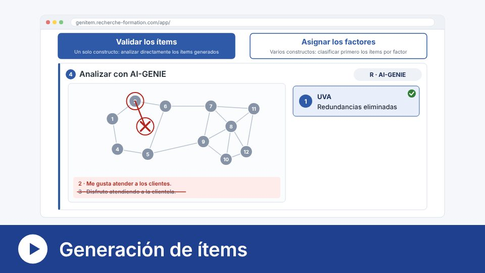</a> |
| [Nuevos ítems](https://genitem.recherche-formation.com/new_item/) | Propone ítems sobre lo que los cuestionarios existentes aún no cubren, sin reproducir ni imitar nunca sus ítems. | <a href="https://genitem.recherche-formation.com/wp-content/uploads/data/info/nouveaux-items-es.mp4">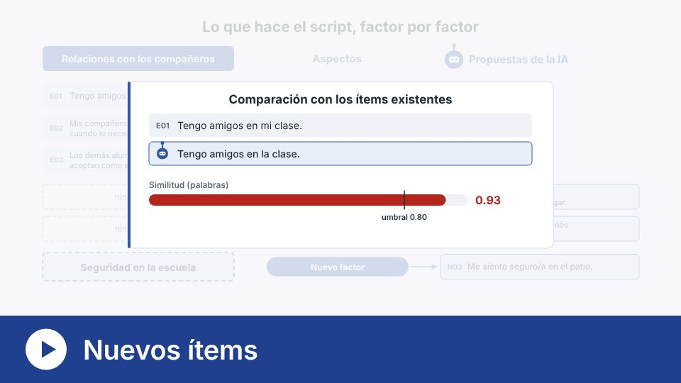</a> |
| [Revisión de cuestionario](https://genitem.recherche-formation.com/revision_questionnaire/) | Compara escalas existentes: redundancias, problemas de redacción y temas no abordados. | <a href="https://genitem.recherche-formation.com/wp-content/uploads/data/info/revision-es.mp4">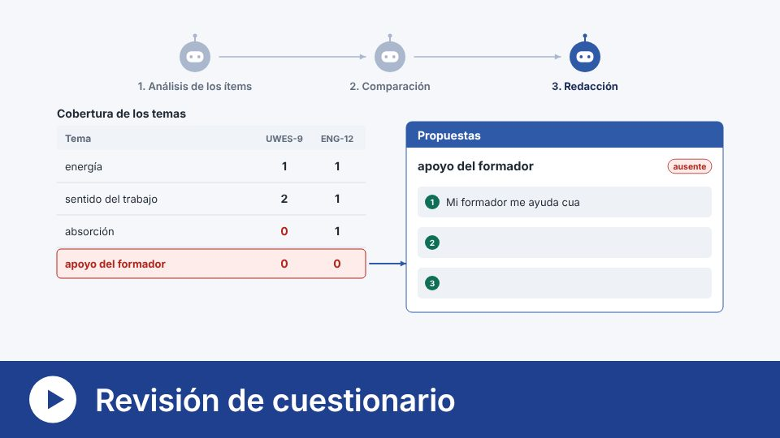</a> |
| [Retrotraducción](https://genitem.recherche-formation.com/retrotraduction/) | Traducción, retrotraducción a ciegas y comparación, con un modelo distinto para cada función. | <a href="https://genitem.recherche-formation.com/wp-content/uploads/data/info/retrotraduction-es.mp4">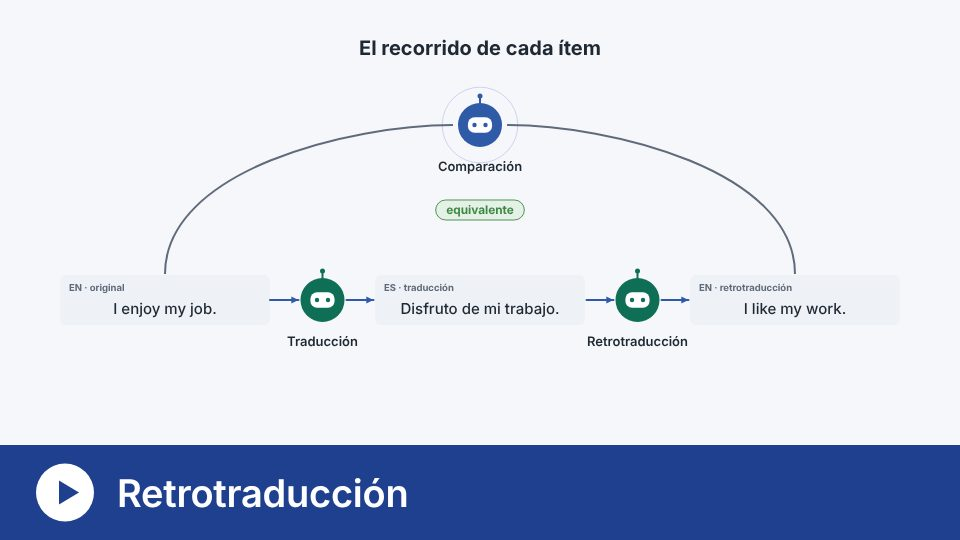</a> |

### Verificar antes de la recogida

| Herramienta | Qué hace | Vídeo |
|---|---|---|
| [Calidad psicométrica](https://genitem.recherche-formation.com/quali_psy/) | Repite la generación de ítems con varios modelos y compara la calidad de sus resultados en un libro de Excel. | <a href="https://genitem.recherche-formation.com/wp-content/uploads/data/info/qualite-psychometrique-es.mp4">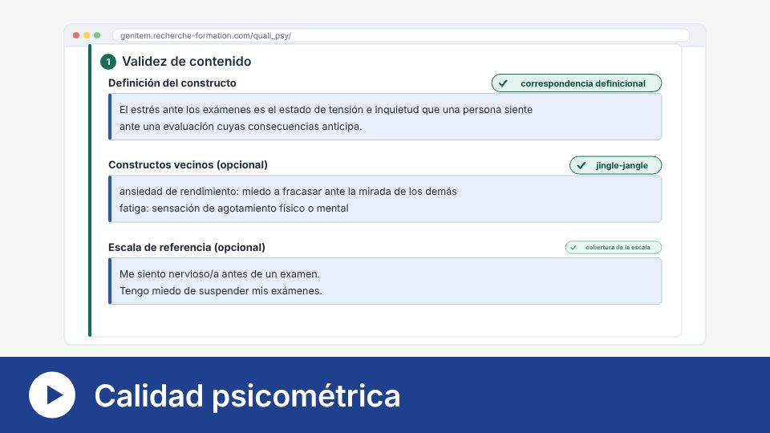</a> |
| [Clasificación de ítems](https://genitem.recherche-formation.com/tri_items/) | Varios modelos clasifican los ítems en factores: consenso, kappa de Fleiss y V de Aiken para cada ítem. | <a href="https://genitem.recherche-formation.com/wp-content/uploads/data/info/tri-items-es.mp4">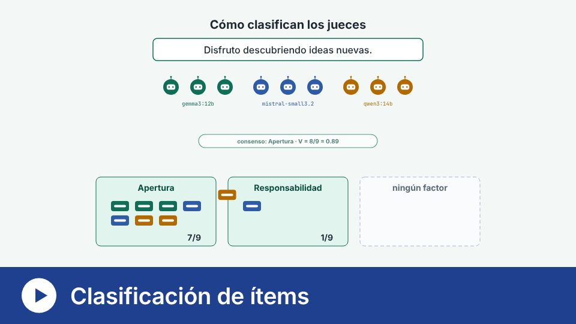</a> |
| [Variación de condiciones](https://genitem.recherche-formation.com/variation_conditions/) | Aplica un cuestionario a modelos de IA en varias condiciones y compara sus respuestas. | <a href="https://genitem.recherche-formation.com/wp-content/uploads/data/info/variation-conditions-es.mp4">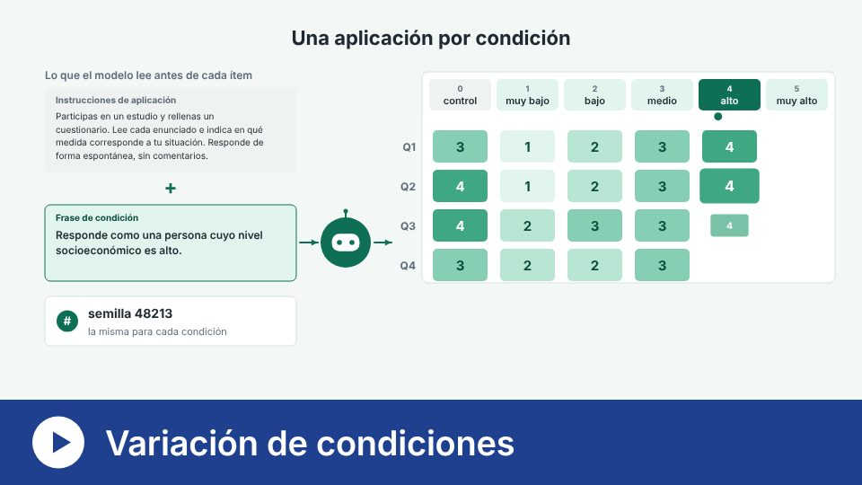</a> |
| [Prueba de modelos](https://genitem.recherche-formation.com/test_modeles/) | Envía la misma consigna a varios modelos y compara lo que producen y el tiempo que tardan. | <a href="https://genitem.recherche-formation.com/wp-content/uploads/data/info/test-modeles-es.mp4">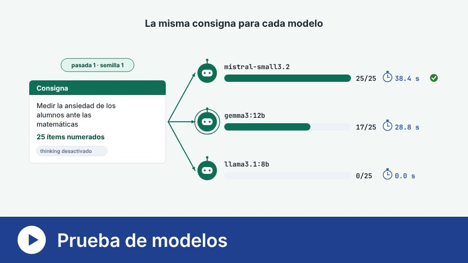</a> |

### Analizar respuestas escritas

| Herramienta | Qué hace | Vídeo |
|---|---|---|
| [Codificación de respuestas abiertas](https://genitem.recherche-formation.com/codage-de-reponse-ouverte/) | Codificación inductiva: varias IA proponen códigos, se redacta un libro de códigos y, después, se codifica el corpus y se mide la fiabilidad. | <a href="https://genitem.recherche-formation.com/wp-content/uploads/data/info/codage-es.mp4">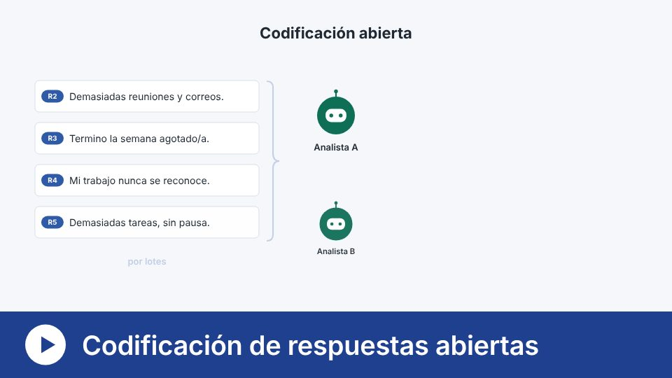</a> |
| [Textometría](https://genitem.recherche-formation.com/textometrie/) | Clasifica los segmentos de texto según su vocabulario (método de Reinert) y los sitúa en mapas. | <a href="https://genitem.recherche-formation.com/wp-content/uploads/data/info/textometrie-es.mp4">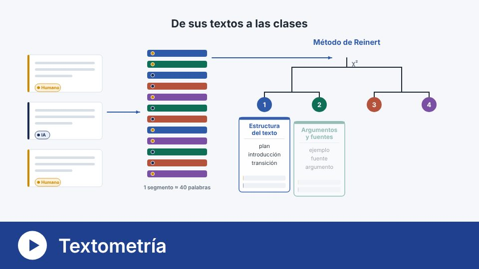</a> |
| [Verbatims](https://genitem.recherche-formation.com/ia-humain/) | Codifica verbatims con el marco de siete niveles de Lee y Ha (2026) y compara la codificación de la IA con la humana. | <a href="https://genitem.recherche-formation.com/wp-content/uploads/data/info/verbatims-es.mp4">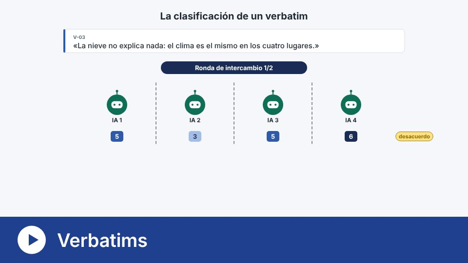</a> |

La [instalación](https://genitem.recherche-formation.com/install/) (Ollama,
Python y R) se guía paso a paso en el sitio web, con su propio
[vídeo](https://genitem.recherche-formation.com/wp-content/uploads/data/info/installation-es.mp4).

---

## Contenido de este repositorio

Este repositorio presenta Genitem y archiva sus versiones citables en Zenodo.
Las herramientas se utilizan desde el sitio web.

| Carpeta o archivo | Contenido |
|---|---|
| `scripts/analyse_genie.R` | Validación estructural de un banco de ítems con AI-GENIE (un solo constructo) |
| `scripts/analyse_genie_multi_construits.R` | El mismo análisis cuando los ítems miden varios constructos |
| `ressources/` | Logotipo, parrillas de codificación y miniaturas de los vídeos |
| `CITATION.cff`, `.zenodo.json` | Cita y descripción del archivo de Zenodo |

---

## Cita

> Jan, D., Béland, S., Vincent, C., Michelot, F., & Caron, É. (2026). *Genitem:
> A user-friendly tool for the generation and pre-validation of items with AI*
> [Computer software]. Zenodo. <https://doi.org/10.5281/zenodo.22801168>

Este DOI remite a todas las versiones. Para la reproducibilidad, cite la versión
que haya utilizado (página de Zenodo, sección *Versions*).

### Trabajos en los que se basa este proyecto

- Russell-Lasalandra, L. L., Christensen, A. P., & Golino, H. (2026).
  Generative psychometrics via AI-GENIE: Automatic item generation and
  validation with network-integrated evaluation. *Behavior Research Methods,
  58*(8), 217. <https://doi.org/10.3758/s13428-026-03082-1>

---

## Licencia

Desde el 6 de noviembre de 2026, todo el repositorio se distribuye bajo la
licencia [CC BY-NC 4.0](https://creativecommons.org/licenses/by-nc/4.0/): uso y
modificación libres, sin fines comerciales, citando a los autores. Véase
[LICENSE](LICENSE). Para un uso comercial, póngase en contacto con los autores.

La versión 0.1 archivada en Zenodo conserva sus licencias originales (MIT para
el código, CC BY 4.0 para la documentación).

---

## Financiación y afiliación

Realizado en el marco de un proyecto afiliado a la **Universidad de Friburgo**,
con el apoyo del **Fonds du centenaire** (proyecto FC-26-989), en colaboración
con la **Universidad de Montreal**.

## Contacto

<info@genitem.education>
