# Genitem

**Generare, adattare e verificare item di questionari con l'IA, interamente sul proprio computer.**

Sito web: <https://genitem.recherche-formation.com>

[Français](README.md) · [English](README.en.md) · [Español](README.es.md) · [Deutsch](README.de.md) · [Português](README.pt.md) · **Italiano**

> **Tradotto con l'IA.** Questo testo è una traduzione prodotta con Claude
> (Anthropic) a partire dall'originale francese. In caso di discrepanza, fa
> fede la versione francese.

## Video di presentazione

<a href="https://genitem.recherche-formation.com/wp-content/uploads/data/genitem-it.mp4">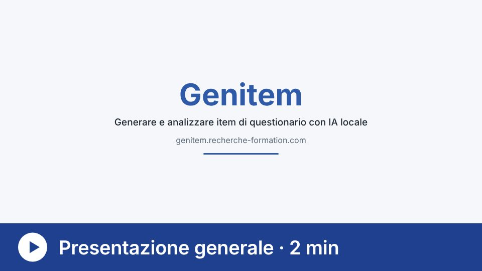</a>

[Guarda la presentazione generale di Genitem (2 minuti)](https://genitem.recherche-formation.com/wp-content/uploads/data/genitem-it.mp4)

---

## Di che cosa si tratta

Genitem (Jan et al., 2026) è una raccolta di strumenti gratuiti, utilizzabili
nel browser, per ricercatrici e ricercatori che costruiscono, adattano e
verificano questionari, indagini e scale di misura. L'IA generativa svolge il
lavoro ripetitivo. La competenza umana mantiene il controllo su ogni decisione.

Tutti i modelli linguistici funzionano **in locale**, sul computer di chi
conduce la ricerca, grazie a [Ollama](https://ollama.com) (Windows, macOS o
Linux). Nessun item, nessuna risposta e nessun dato personale viene inviato a
un servizio esterno. Genitem è quindi adatto a studi soggetti a requisiti etici
o di protezione dei dati rigorosi.

L'interfaccia è disponibile in sei lingue: francese, inglese, spagnolo,
tedesco, portoghese e italiano.

---

## Lo strumento centrale: la generazione di item

La generazione di item avviene in due fasi.

1. **Agenti IA organizzati in una gerarchia.** Un configuratore ne coordina il
   lavoro. La persona che fa ricerca sceglie il modello e definisce il ruolo di
   ciascun agente. Per esempio, un agente redige un insieme di item su un dato
   costrutto, poi diversi agenti revisori (di solito da tre a otto) verificano
   in modo indipendente che gli item restino in tema, rispettino le regole di
   redazione e siano privi di distorsioni etiche. Questo ciclo di revisione si
   ripete più volte, e ogni agente tiene conto delle osservazioni degli altri,
   prima che un agente finale raccolga gli item in un pool.
2. **Una validazione psicometrica.** Il pacchetto R AI-GENIE
   (Russell-Lasalandra et al., 2026) analizza questo pool con la psicometria di
   rete, elimina gli item ridondanti o instabili e conserva quelli più stabili.
   Quando si misurano più costrutti, ogni item viene prima assegnato al proprio
   fattore.

La forza di Genitem sta nel rendere la parte tecnica semplice e comprensibile,
lasciando al giudizio umano il ruolo principale nella guida degli agenti IA.

---

## Gli strumenti

Ogni strumento ha il suo video di presentazione di circa un minuto
(sottotitolato, in sei lingue sul sito). I link qui sotto portano alla versione
italiana.

### Costruire e adattare

| Strumento | Che cosa fa | Video |
|---|---|---|
| [Generazione di item](https://genitem.recherche-formation.com/app/) | Agenti IA redigono e rivedono un pool di item, poi AI-GENIE ne verifica la struttura. | <a href="https://genitem.recherche-formation.com/wp-content/uploads/data/info/generation-items-it.mp4">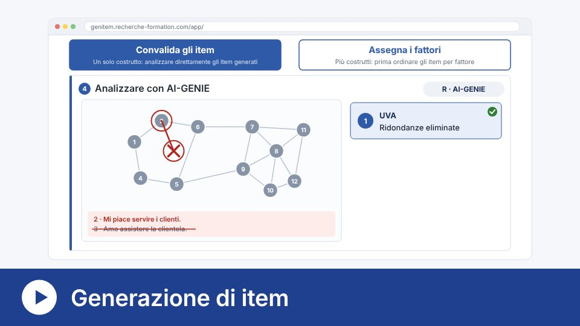</a> |
| [Nuovi item](https://genitem.recherche-formation.com/new_item/) | Propone item su ciò che i questionari esistenti non coprono ancora, senza mai riprodurne o imitarne gli item. | <a href="https://genitem.recherche-formation.com/wp-content/uploads/data/info/nouveaux-items-it.mp4">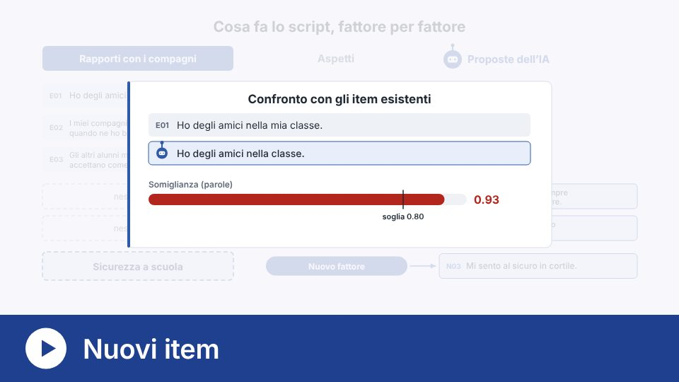</a> |
| [Revisione del questionario](https://genitem.recherche-formation.com/revision_questionnaire/) | Confronta scale esistenti: ridondanze, problemi di formulazione e temi non trattati. | <a href="https://genitem.recherche-formation.com/wp-content/uploads/data/info/revision-it.mp4">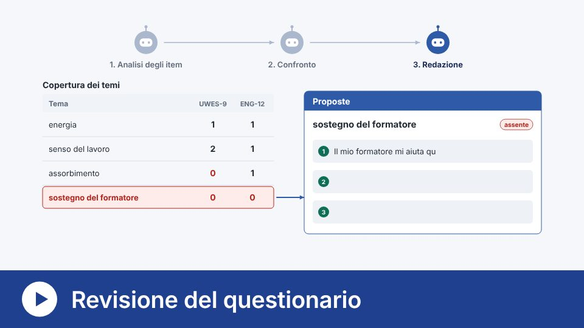</a> |
| [Retrotraduzione](https://genitem.recherche-formation.com/retrotraduction/) | Traduzione, retrotraduzione alla cieca e confronto, con un modello diverso per ogni ruolo. | <a href="https://genitem.recherche-formation.com/wp-content/uploads/data/info/retrotraduction-it.mp4">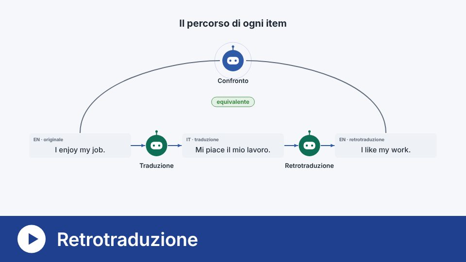</a> |

### Verificare prima della raccolta

| Strumento | Che cosa fa | Video |
|---|---|---|
| [Qualità psicometrica](https://genitem.recherche-formation.com/quali_psy/) | Ripete la generazione di item con più modelli e confronta la qualità dei risultati in una cartella di lavoro Excel. | <a href="https://genitem.recherche-formation.com/wp-content/uploads/data/info/qualite-psychometrique-it.mp4">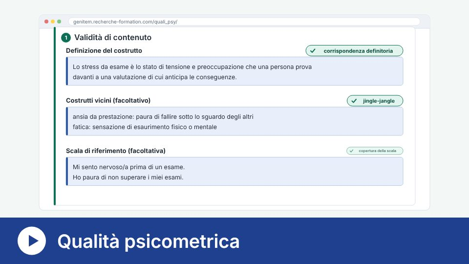</a> |
| [Selezione degli item](https://genitem.recherche-formation.com/tri_items/) | Più modelli assegnano gli item ai fattori: consenso, kappa di Fleiss e V di Aiken per ogni item. | <a href="https://genitem.recherche-formation.com/wp-content/uploads/data/info/tri-items-it.mp4">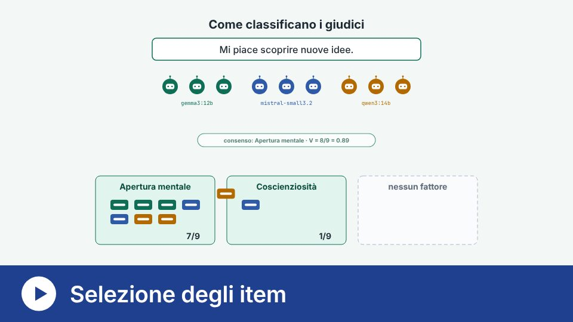</a> |
| [Variazione delle condizioni](https://genitem.recherche-formation.com/variation_conditions/) | Somministra un questionario a modelli IA in più condizioni, poi ne confronta le risposte. | <a href="https://genitem.recherche-formation.com/wp-content/uploads/data/info/variation-conditions-it.mp4">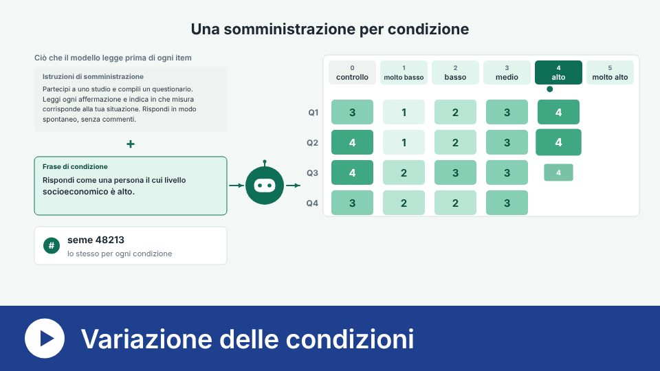</a> |
| [Test dei modelli](https://genitem.recherche-formation.com/test_modeles/) | Invia la stessa consegna a più modelli e confronta ciò che producono e il tempo che impiegano. | <a href="https://genitem.recherche-formation.com/wp-content/uploads/data/info/test-modeles-it.mp4">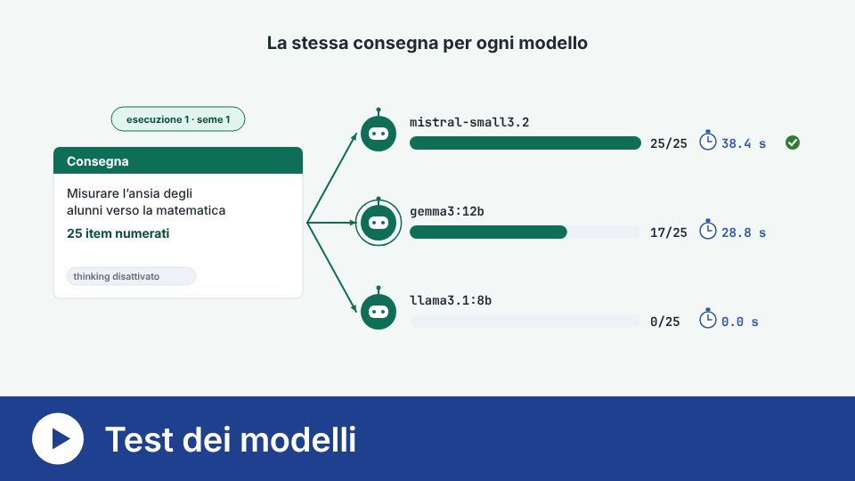</a> |

### Analizzare risposte scritte

| Strumento | Che cosa fa | Video |
|---|---|---|
| [Codifica delle risposte aperte](https://genitem.recherche-formation.com/codage-de-reponse-ouverte/) | Codifica induttiva: più IA propongono codici, si redige un libro dei codici, poi il corpus viene codificato e se ne misura l'affidabilità. | <a href="https://genitem.recherche-formation.com/wp-content/uploads/data/info/codage-it.mp4">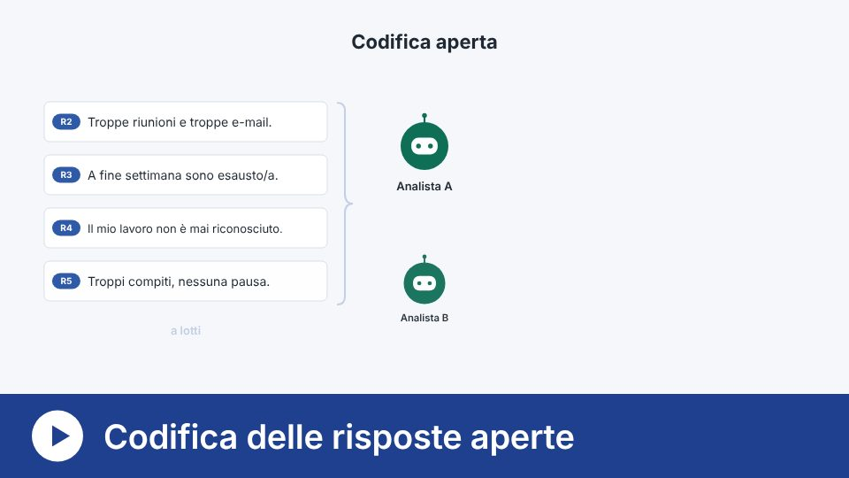</a> |
| [Textometria](https://genitem.recherche-formation.com/textometrie/) | Classifica i segmenti di testo in base al lessico (metodo di Reinert) e li colloca su mappe. | <a href="https://genitem.recherche-formation.com/wp-content/uploads/data/info/textometrie-it.mp4">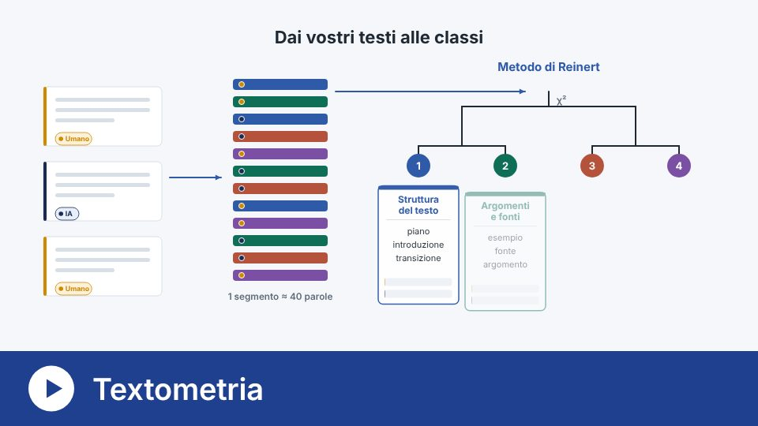</a> |
| [Verbatim](https://genitem.recherche-formation.com/ia-humain/) | Codifica verbatim con il quadro a sette livelli di Lee e Ha (2026) e confronta la codifica dell'IA con quella umana. | <a href="https://genitem.recherche-formation.com/wp-content/uploads/data/info/verbatims-it.mp4">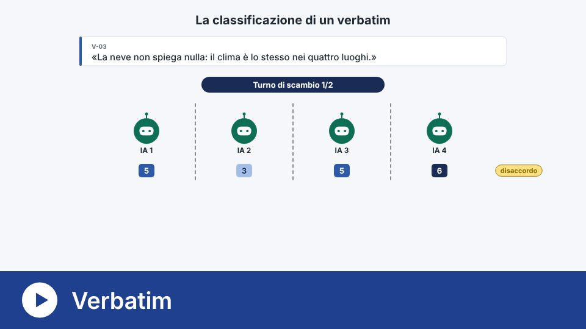</a> |

L'[installazione](https://genitem.recherche-formation.com/install/) (Ollama,
Python e R) è guidata passo dopo passo sul sito, con il suo
[video](https://genitem.recherche-formation.com/wp-content/uploads/data/info/installation-it.mp4).

---

## Contenuto di questo repository

Questo repository presenta Genitem e archivia le sue versioni citabili su
Zenodo. Gli strumenti si usano dal sito.

| Cartella o file | Contenuto |
|---|---|
| `scripts/analyse_genie.R` | Validazione strutturale di un pool di item con AI-GENIE (un solo costrutto) |
| `scripts/analyse_genie_multi_construits.R` | La stessa analisi quando gli item misurano più costrutti |
| `ressources/` | Logo, griglie di codifica e miniature dei video |
| `CITATION.cff`, `.zenodo.json` | Citazione e descrizione dell'archivio Zenodo |

---

## Citazione

> Jan, D., Béland, S., Vincent, C., Michelot, F., & Caron, É. (2026). *Genitem:
> A user-friendly tool for the generation and pre-validation of items with AI*
> [Computer software]. Zenodo. <https://doi.org/10.5281/zenodo.22801168>

Questo DOI rimanda a tutte le versioni. Per la riproducibilità, citate la
versione che avete utilizzato (pagina Zenodo, sezione *Versions*).

### Lavori su cui si basa questo progetto

- Russell-Lasalandra, L. L., Christensen, A. P., & Golino, H. (2026).
  Generative psychometrics via AI-GENIE: Automatic item generation and
  validation with network-integrated evaluation. *Behavior Research Methods,
  58*(8), 217. <https://doi.org/10.3758/s13428-026-03082-1>

---

## Licenza

Dal 6 novembre 2026, l'intero repository è distribuito con licenza
[CC BY-NC 4.0](https://creativecommons.org/licenses/by-nc/4.0/): uso e modifica
liberi, senza scopi commerciali, citando gli autori. Vedere
[LICENSE](LICENSE). Per un uso commerciale, contattare gli autori.

La versione 0.1 archiviata su Zenodo mantiene le licenze originali (MIT per il
codice, CC BY 4.0 per la documentazione).

---

## Finanziamento e affiliazione

Realizzato nell'ambito di un progetto affiliato all'**Università di Friburgo**,
con il sostegno del **Fonds du centenaire** (progetto FC-26-989), in
collaborazione con l'**Université de Montréal**.

## Contatti

<info@genitem.education>
