# Genitem

**Gerar, adaptar e verificar itens de questionários com IA, inteiramente no seu próprio computador.**

Site: <https://genitem.recherche-formation.com>

[Français](README.md) · [English](README.en.md) · [Español](README.es.md) · [Deutsch](README.de.md) · **Português** · [Italiano](README.it.md)

> **Tradução feita com IA.** Este texto é uma tradução produzida com Claude
> (Anthropic) a partir do original em francês. Em caso de divergência,
> prevalece a versão em francês.

## Vídeo de apresentação

<a href="https://genitem.recherche-formation.com/wp-content/uploads/data/genitem-pt.mp4">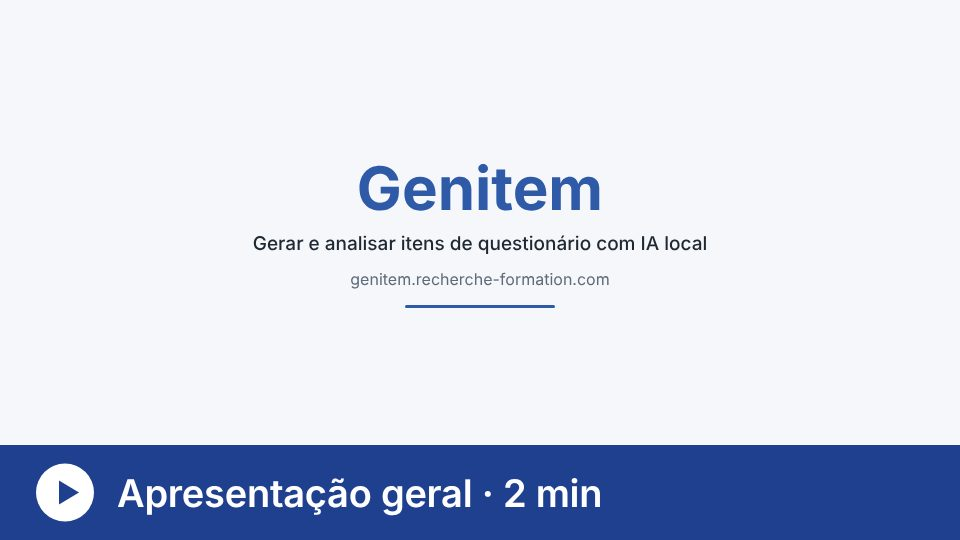</a>

[Assistir à apresentação geral do Genitem (2 minutos)](https://genitem.recherche-formation.com/wp-content/uploads/data/genitem-pt.mp4)

---

## O que é

O Genitem (Jan et al., 2026) é um conjunto de ferramentas gratuitas, utilizáveis
no navegador, para pesquisadoras e pesquisadores que constroem, adaptam e
verificam questionários, enquetes e escalas de medida. A IA generativa faz o
trabalho repetitivo. A expertise humana mantém o controle de cada decisão.

Todos os modelos de linguagem rodam **localmente**, no computador de quem
conduz a pesquisa, graças ao [Ollama](https://ollama.com) (Windows, macOS ou
Linux). Nenhum item, resposta ou dado pessoal é enviado a um serviço externo.
Por isso, o Genitem é adequado a estudos sujeitos a exigências éticas ou de
proteção de dados rigorosas.

A interface está disponível em seis idiomas: francês, inglês, espanhol, alemão,
português e italiano.

---

## A ferramenta central: a geração de itens

A geração de itens acontece em duas etapas.

1. **Agentes de IA organizados em uma hierarquia.** Um configurador coordena o
   trabalho deles. A pessoa pesquisadora escolhe o modelo e define o papel de
   cada agente. Por exemplo, um agente redige um conjunto de itens sobre um
   construto dado e, em seguida, vários agentes revisores (em geral de três a
   oito) verificam de forma independente se os itens permanecem no tema,
   respeitam as regras de redação e estão livres de vieses éticos. Esse ciclo
   de revisão se repete várias vezes, com cada agente levando em conta os
   comentários dos outros, antes que um agente final reúna os itens em um banco.
2. **Uma validação psicométrica.** O pacote R AI-GENIE (Russell-Lasalandra et
   al., 2026) analisa esse banco por meio da psicometria de redes, remove os
   itens redundantes ou instáveis e mantém os mais estáveis. Quando vários
   construtos são medidos, cada item é primeiro atribuído ao seu fator.

A força do Genitem está em tornar a parte técnica simples e compreensível,
deixando ao julgamento humano o papel principal na condução dos agentes de IA.

---

## As ferramentas

Cada ferramenta tem seu vídeo de apresentação de cerca de um minuto (legendado,
em seis idiomas no site). Os links abaixo levam à versão em português.

### Construir e adaptar

| Ferramenta | O que faz | Vídeo |
|---|---|---|
| [Geração de itens](https://genitem.recherche-formation.com/app/) | Agentes de IA redigem e revisam um banco de itens e, em seguida, o AI-GENIE verifica sua estrutura. | <a href="https://genitem.recherche-formation.com/wp-content/uploads/data/info/generation-items-pt.mp4">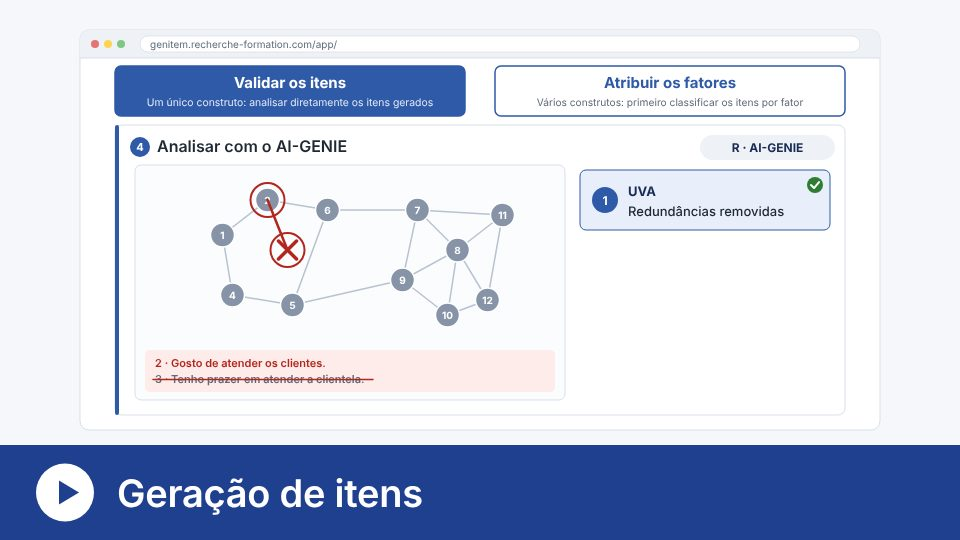</a> |
| [Novos itens](https://genitem.recherche-formation.com/new_item/) | Propõe itens sobre o que os questionários existentes ainda não cobrem, sem jamais reproduzir ou imitar seus itens. | <a href="https://genitem.recherche-formation.com/wp-content/uploads/data/info/nouveaux-items-pt.mp4">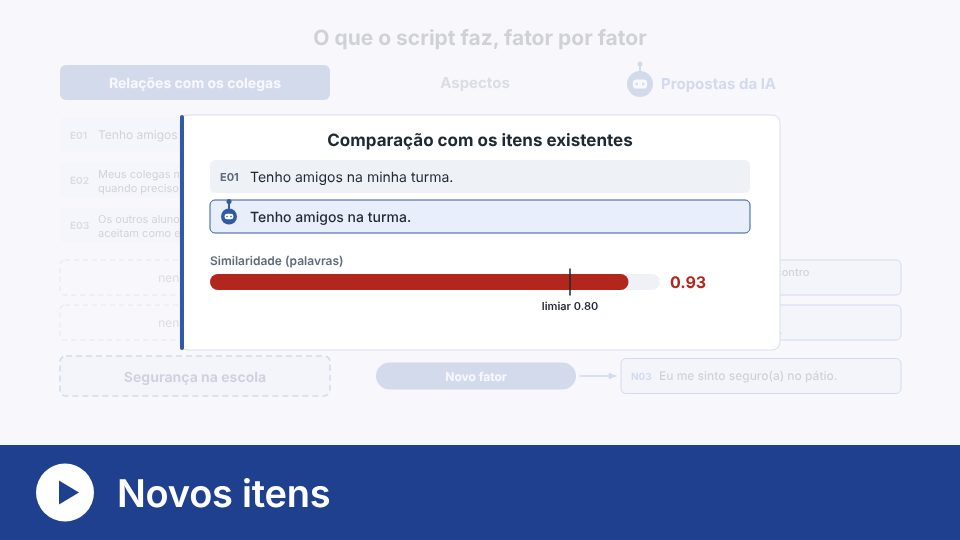</a> |
| [Revisão de questionário](https://genitem.recherche-formation.com/revision_questionnaire/) | Compara escalas existentes: redundâncias, problemas de redação e temas não abordados. | <a href="https://genitem.recherche-formation.com/wp-content/uploads/data/info/revision-pt.mp4">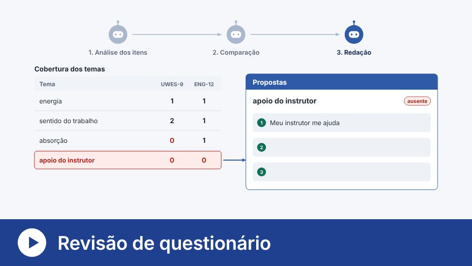</a> |
| [Retrotradução](https://genitem.recherche-formation.com/retrotraduction/) | Tradução, retrotradução às cegas e comparação, com um modelo diferente para cada papel. | <a href="https://genitem.recherche-formation.com/wp-content/uploads/data/info/retrotraduction-pt.mp4">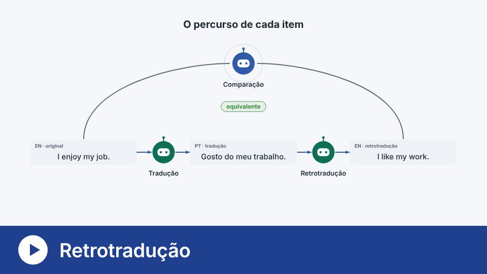</a> |

### Verificar antes da coleta

| Ferramenta | O que faz | Vídeo |
|---|---|---|
| [Qualidade psicométrica](https://genitem.recherche-formation.com/quali_psy/) | Repete a geração de itens com vários modelos e compara a qualidade dos resultados em uma pasta de trabalho do Excel. | <a href="https://genitem.recherche-formation.com/wp-content/uploads/data/info/qualite-psychometrique-pt.mp4">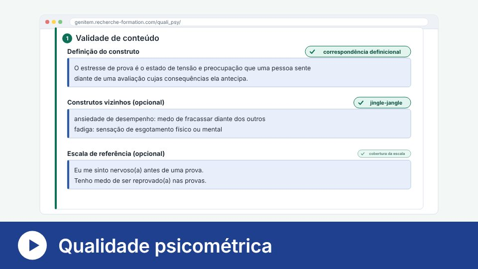</a> |
| [Triagem de itens](https://genitem.recherche-formation.com/tri_items/) | Vários modelos classificam os itens em fatores: consenso, kappa de Fleiss e V de Aiken para cada item. | <a href="https://genitem.recherche-formation.com/wp-content/uploads/data/info/tri-items-pt.mp4">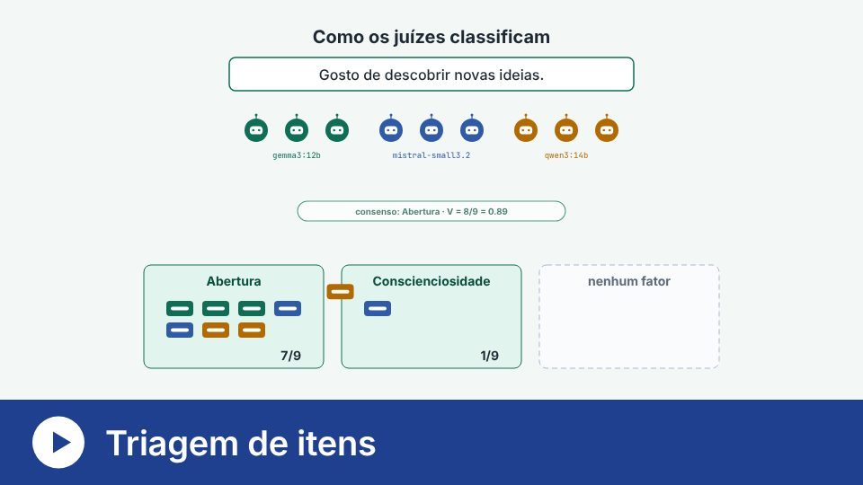</a> |
| [Variação de condições](https://genitem.recherche-formation.com/variation_conditions/) | Aplica um questionário a modelos de IA sob várias condições e compara suas respostas. | <a href="https://genitem.recherche-formation.com/wp-content/uploads/data/info/variation-conditions-pt.mp4">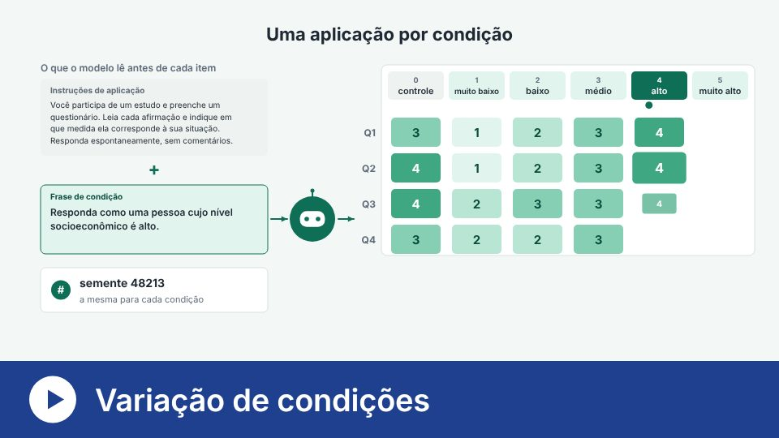</a> |
| [Teste de modelos](https://genitem.recherche-formation.com/test_modeles/) | Envia a mesma instrução a vários modelos e compara o que eles produzem e o tempo que levam. | <a href="https://genitem.recherche-formation.com/wp-content/uploads/data/info/test-modeles-pt.mp4">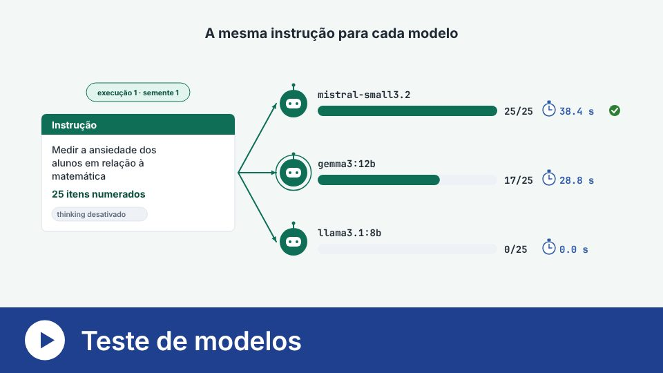</a> |

### Analisar respostas escritas

| Ferramenta | O que faz | Vídeo |
|---|---|---|
| [Codificação de respostas abertas](https://genitem.recherche-formation.com/codage-de-reponse-ouverte/) | Codificação indutiva: várias IA propõem códigos, um livro de códigos é redigido e, em seguida, o corpus é codificado e a confiabilidade medida. | <a href="https://genitem.recherche-formation.com/wp-content/uploads/data/info/codage-pt.mp4">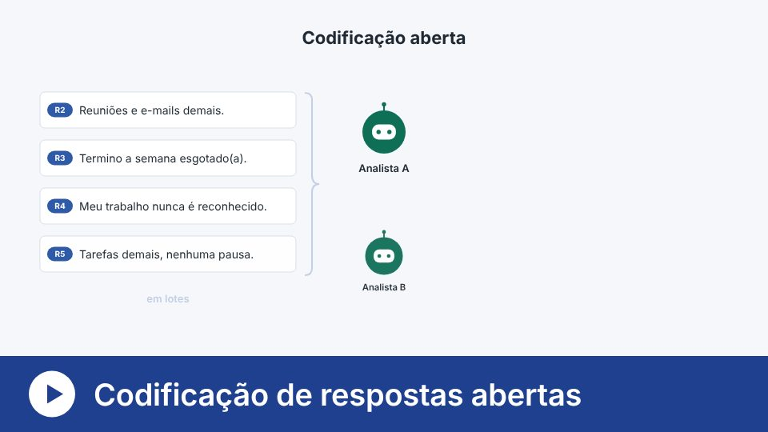</a> |
| [Textometria](https://genitem.recherche-formation.com/textometrie/) | Classifica os segmentos de texto segundo o vocabulário (método de Reinert) e os posiciona em mapas. | <a href="https://genitem.recherche-formation.com/wp-content/uploads/data/info/textometrie-pt.mp4">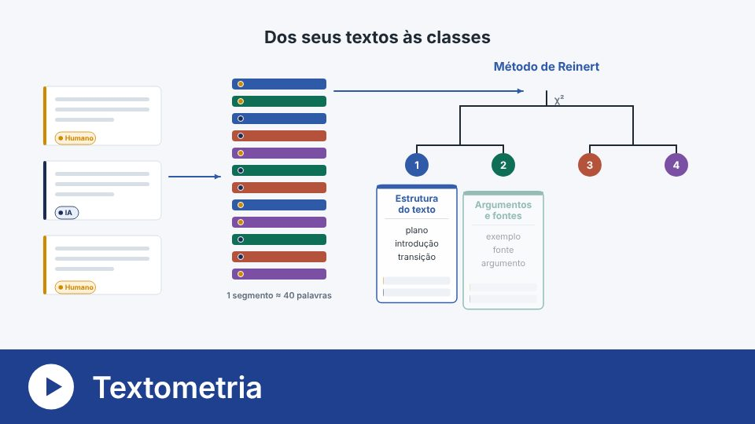</a> |
| [Verbatims](https://genitem.recherche-formation.com/ia-humain/) | Codifica verbatims com o quadro de sete níveis de Lee e Ha (2026) e compara a codificação da IA com a humana. | <a href="https://genitem.recherche-formation.com/wp-content/uploads/data/info/verbatims-pt.mp4">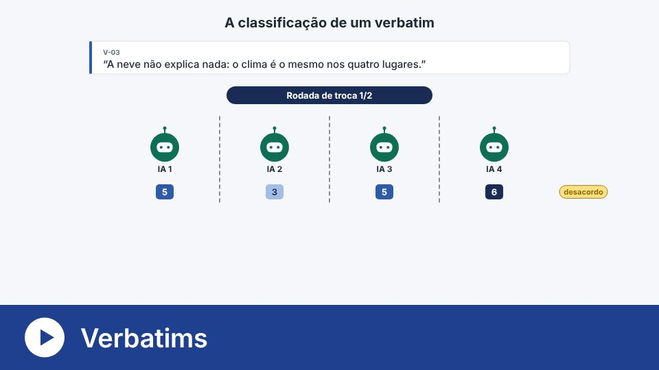</a> |

A [instalação](https://genitem.recherche-formation.com/install/) (Ollama,
Python e R) é guiada passo a passo no site, com seu próprio
[vídeo](https://genitem.recherche-formation.com/wp-content/uploads/data/info/installation-pt.mp4).

---

## Conteúdo deste repositório

Este repositório apresenta o Genitem e arquiva suas versões citáveis no Zenodo.
As ferramentas são usadas a partir do site.

| Pasta ou arquivo | Conteúdo |
|---|---|
| `scripts/analyse_genie.R` | Validação estrutural de um banco de itens com o AI-GENIE (um único construto) |
| `scripts/analyse_genie_multi_construits.R` | A mesma análise quando os itens medem vários construtos |
| `ressources/` | Logotipo, grades de codificação e miniaturas dos vídeos |
| `CITATION.cff`, `.zenodo.json` | Citação e descrição do arquivo no Zenodo |

---

## Citação

> Jan, D., Béland, S., Vincent, C., Michelot, F., & Caron, É. (2026). *Genitem:
> A user-friendly tool for the generation and pre-validation of items with AI*
> [Computer software]. Zenodo. <https://doi.org/10.5281/zenodo.22801168>

Este DOI remete a todas as versões. Para a reprodutibilidade, cite a versão que
você utilizou (página do Zenodo, seção *Versions*).

### Trabalhos nos quais este projeto se baseia

- Russell-Lasalandra, L. L., Christensen, A. P., & Golino, H. (2026).
  Generative psychometrics via AI-GENIE: Automatic item generation and
  validation with network-integrated evaluation. *Behavior Research Methods,
  58*(8), 217. <https://doi.org/10.3758/s13428-026-03082-1>

---

## Licença

Desde 6 de novembro de 2026, todo o repositório é distribuído sob a licença
[CC BY-NC 4.0](https://creativecommons.org/licenses/by-nc/4.0/): uso e
modificação livres, sem fins comerciais, citando os autores. Veja
[LICENSE](LICENSE). Para uso comercial, entre em contato com os autores.

A versão 0.1 arquivada no Zenodo mantém suas licenças originais (MIT para o
código, CC BY 4.0 para a documentação).

---

## Financiamento e vínculo

Realizado no âmbito de um projeto vinculado à **Universidade de Friburgo**, com
o apoio do **Fonds du centenaire** (projeto FC-26-989), em colaboração com a
**Universidade de Montreal**.

## Contato

<info@genitem.education>
